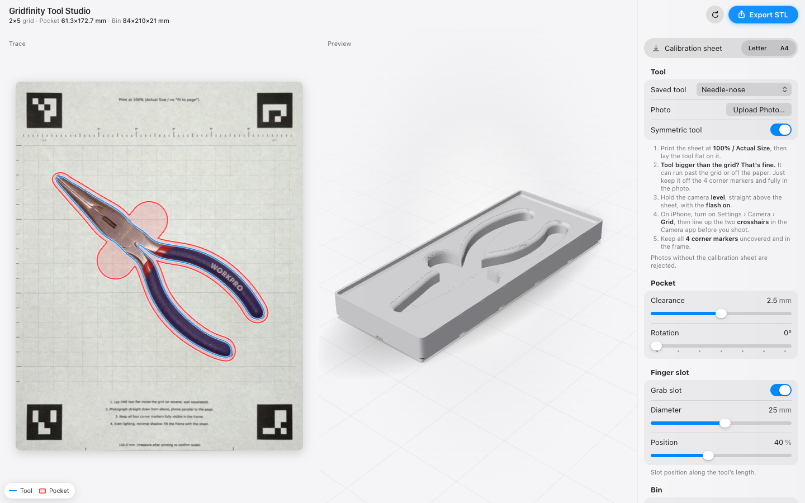

# Gridfinity Tool Studio

Turn a phone photo of a hand tool into a 3D‑printable [gridfinity](https://gridfinity.xyz) bin with a tool‑shaped pocket.
It runs entirely in your browser: **https://gridfinitytools.com** (also at https://gridfinity-tool-studio.pages.dev)



1. **Print** the calibration sheet (Letter or A4, linked in the app) at 100 % / Actual Size.
2. **Photograph** the tool lying flat on it, from straight above, flash on.
3. **Upload** the photo, then tune the pocket, finger slot, bin height, depth and edge rounding, and watch the
   bin update in 3D.
4. **Export STL** and print.

The four corner markers on the sheet give exact real‑world scale and remove perspective, so the pocket is
measured in millimetres, not guessed. The tool is cut out of the photo with an AI background‑removal model,
which handles shiny metal and black handles that simple thresholding misses. Two built‑in demo tools (groove‑joint
pliers and a stud finder) let you try it without a photo.

## Privacy

Your photos never leave your device: sheet detection, background removal, tracing and the 3D bin all run in
the browser. Uploaded tools are kept only in this browser's storage (the newest 20), and you can remove them
in the app. The first upload asks before downloading the background‑removal model (about 88 MB) from Hugging
Face; the engine that runs it (onnxruntime) comes from jsDelivr. Both are cached by the browser. There are no
analytics scripts, accounts or cookies; the app only counts a few steps anonymously (upload, export) by
requesting an empty file from the site. Details: [web/privacy.html](web/privacy.html).

## Taking a good photo

- Print the sheet at **100 % / Actual Size** (no "fit to page"). Check the 100 mm bar with a ruler.
- Lay the tool flat. **It's fine if it's bigger than the grid** or hangs off the paper, as long as it doesn't
  cover a corner marker and is fully in the photo.
- Hold the camera **level**, straight above the sheet, with the **flash on**.
- **iPhone:** Settings › Camera › **Grid** on, then line up the two crosshairs in the Camera app before shooting.
- Keep all **4 corner markers** visible. Photos without the whole sheet are rejected.

JPEG, PNG and HEIC (iPhone) photos all work. The first upload takes longer while the model downloads; later
uploads reuse the cached copy. Browsers with WebGPU run the model on the GPU; others fall back to WebAssembly,
which takes some seconds per photo.

## What you can tune

| Setting | What it does |
|---|---|
| Symmetric tool | Mirror‑averages the outline about the tool's own axis for a clean, even cutout |
| Clearance | Gap between the tool and the pocket wall |
| Rotation | Rotates the cutout inside the bin |
| Finger slot | A rounded grab slot across the tool: diameter and position along its length |
| Height | Bin height in gridfinity units (7 mm each) |
| Depth | How deep the tool pocket is |
| Top fillet | Rounded lead‑in at the pocket opening |
| Bottom round | Rounds the pocket floor into the walls |
| Holes | Base holes per gridfinity cell corner: 6×2 mm magnets (6.5 × 2.4 mm), M3 screws (3 × 6 mm) or both |
| Corners only | Puts the holes only at the bin's four outer corners |
| Stacking lip | The rim that lets bins stack; off gives a flat top and 4.4 mm more pocket depth |
| Half-grid feet | One foot per 21 mm half cell, so the footprint grows in half cells (1.5, 2.5… units). The bin still sits on a standard 42 mm baseplate; base holes are off, since they don't fit on the smaller feet |

Bins use the standard gridfinity 42 mm grid, base profile and stacking lip, and the footprint grows in whole
cells (or half cells, with half-grid feet) to fit the pocket. Screw holes raise the lowest pocket floor to
6.8 mm so the pocket can't break into them. The 3D preview keeps your camera angle between rebuilds;
double‑click it to re‑frame.

The trace shows the pocket's width and length as dimension lines, measured along the tool's own axes. The
pocket and tool sizes are also listed under the Pocket settings.

**Trace outline › SVG / DXF** saves the traced outline and the pocket (clearance plus finger slot) at 1:1 in
millimetres, on separate layers, for laser‑cutting foam inserts or drawing your own bin in CAD. DXF is R12,
which AutoCAD, Fusion, Onshape and LightBurn all open; DWG isn't offered because it's a closed format.

## How it works

The app in `web/` is a static site (Vite + TypeScript). The UI is `web/index.html`, `web/src/styles.css` and
`web/src/main.ts`; the pipeline runs in a Web Worker (`web/src/worker/`).

1. **Decode:** JPEG/PNG through the browser, HEIC through heic-to, a current libheif build (`web/src/vision/decode.ts`).
2. **Sheet:** ArUco markers (OpenCV.js, 4×4 dictionary) → homography to sheet millimetres
   (`web/src/vision/sheet.ts`).
3. **Cut‑out:** IS‑Net (fp16 ONNX, onnxruntime‑web on WebGPU or WASM) on the perspective‑corrected page, then
   again on a tight crop around the tool for precise edges (`web/src/vision/segment.ts`).
4. **Outline:** largest contour → smoothing spline → straightened to the tool's long axis, optionally
   mirror‑averaged (`outline.ts`, `smooth.ts`, `symmetry.ts`).
5. **Pocket:** offset for clearance, plus a stadium‑shaped finger slot (`web/src/geometry/pocket.ts`).
6. **Bin:** [manifold](https://github.com/elalish/manifold) (WebAssembly) builds the gridfinity feet, body and
   stacking lip, and subtracts the pocket with stepped round‑overs, so the STL is always watertight
   (`web/src/geometry/bin.ts`). Three.js draws the preview.

The Python package in `src/gts/` is the reference implementation the browser port was checked against; the
JSON fixtures in `tests/fixtures/` pin the two to the same results. Base holes, the lip toggle and half-grid feet exist only in
the browser app.

## Developing the web app

Needs Node 22 or newer.

```sh
cd web
npm ci
npm run dev          # http://localhost:5173
npm test             # unit tests (vitest)
npm run typecheck
npm run build        # → web/dist
npm run e2e          # end-to-end tests (Playwright) against the production build
```

- The unit tests that run the model download it once (~88 MB) to `web/.cache/` (gitignored) and skip when
  offline. The upload end‑to‑end test reuses that file and skips if it isn't there.
- `npm run e2e` uses the system Google Chrome by default. Set `CHROME_PATH` to another Chrome, or
  `PW_BUNDLED_CHROMIUM=1` to use Playwright's Chromium after `npx playwright install chromium`.
- `vite dev`/`vite preview` send no cross‑origin isolation headers, so onnxruntime runs single‑threaded
  locally. The deployed site sets them.

See [CONTRIBUTING.md](CONTRIBUTING.md) for the full workflow.

## Python reference and command‑line tools

Optional: you don't need Python to use or develop the web app. Requires Python 3.11 or newer. Use a virtual
environment (Homebrew's Python refuses global `pip install`):

```sh
python3.11 -m venv .venv
source .venv/bin/activate
pip install -r requirements.txt
python -m pytest -q
```

- The command‑line tracer uses [rembg](https://github.com/danielgatis/rembg), which downloads the IS‑Net model
  (~180 MB) to `~/.rembg/models/` on first use (older rembg versions: `~/.u2net/`). The tests don't need it.
- HEIC photos need the optional `pip install pillow-heif`; otherwise convert them to JPEG first.
- Run the scripts with `python -I` (isolated mode).

| Path | Purpose |
|---|---|
| `src/gts/` | The reference pipeline as a package: sheet detection, tracing, pocket geometry, bin |
| `src/sheetgen.py` | Regenerates the calibration sheet PDFs, preview and `sheet_markers.json` in `assets/sheet/` (tracked files): `python -I src/sheetgen.py letter` or `a4` |
| `src/analyze_rembg.py` | Traces one photo of your own: `python -I src/analyze_rembg.py photo.jpg` → mask and overlay in `out/` |
| `src/holder.py` | Builds the pockets of the four fixture tools from `assets/presets/` into `out/` (run this first) |
| `src/gridfinity_bin.py`, `src/stl_block.py`, `src/pack.py` | Then: a gridfinity bin STL, a simple test‑print block, or a multi‑tool baseplate layout, from the pockets in `out/` |
| `src/gf_build_all.py`, `src/gf_build.py`, `src/gridfinity.fs.tmpl`, `src/onshape.py` | Builds the bins as a parametric Onshape FeatureScript feature. Needs an Onshape API key in `~/.onshape_key` and an existing document's ids in `/tmp/gf_onshape.json` |
| `scripts/make_preset_assets.py` | Turns a photo on the sheet into a demo tool's files in `assets/presets/`: `python -I scripts/make_preset_assets.py photo.jpg <tool>` (add the tool to `TOOLS`, `SYM_DEFAULT` and `PRESET_REGIONS` in `src/gts/constants.py` first) |
| `scripts/build_presets.py` | Writes the web app's demo presets and sheet PDFs (`web/public/`), and the fixture tools' presets for the web tests (`tests/fixtures/web-presets/`) |
| `scripts/make_fixtures.py` | Writes the parity fixtures in `tests/fixtures/` from the reference |
| `assets/presets/` | The two demo tools (`groovejoint`, `studfinder`) and the four tools the parity fixtures are made from (`needlenose`, `combopliers`, `flushcutter`, `stripper`): photo (`<tool>.jpg`), rectified image (`<tool>_rect.png`) and mask (`<tool>_mask.png`) |
| `assets/sheet/` | Calibration sheet PDFs, preview and `sheet_markers.json` (marker positions in mm) |
| `docs/design-spec.md` | Design spec for the UI |

The command‑line tools write their generated files to `out/`, which is not tracked. `src/sheetgen.py` is the
exception: it overwrites the tracked sheet files in `assets/sheet/` (then run `scripts/build_presets.py` to
copy them into the web app).

## License

MIT, see [LICENSE](LICENSE). Third‑party notices, including the caveat on the AI model weights, are in
[NOTICE](NOTICE).
